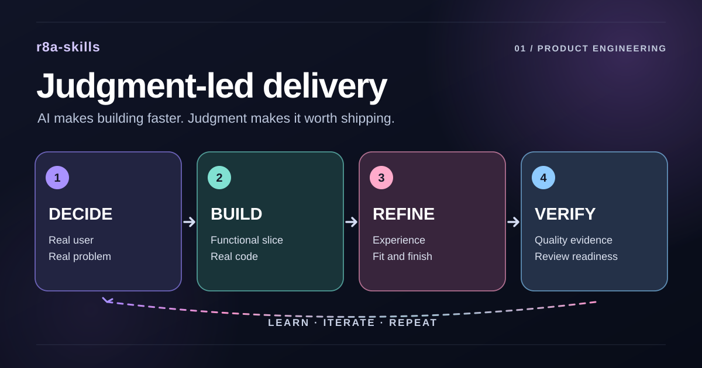

# r8a-skills

**A collection of reusable Agent Skills for coding agents.**

This repository brings together focused instruction packages for tools such as Codex and Claude Code. Each skill is independently installable: explore the catalog below, choose one, or install the full collection. The collection starts with one skill, Judgment-led delivery, and we'll keep adding more over time.

## Skills in this collection

### [Judgment-led delivery](skills/judgment-led-delivery/README.md)



**Build what's worth building. Know when not to.**

Helps coding agents assess whether a product change is useful before implementing it. The skill examines existing behavior, weighs meaningful alternatives, builds working interactions when appropriate, and verifies the user experience against actual evidence. It adapts to the task instead of requiring a heavyweight process.

## Install the collection

Install **all skills** in this repository globally for Codex and Claude Code:

```bash
npx skills add rafa-ochoa/r8a-skills -g -a codex -a claude-code -y
```

Requires Node.js 22.20 or later. The command selects Codex and Claude Code directly, so there is no agent-selection screen.

- Remove `-g` to install only in the current project.
- Change the `-a` values to target different supported agents.
- To install **one skill**, use the command in that skill's README.

## Update installed skills

Update all globally installed skills, including those from this collection:

```bash
npx skills update -g -y
```

This command also updates skills from other repositories. To update a single skill, use the command in its README.

## Get started

Open a project in your coding agent and give it a task. For example:

> Use judgment-led-delivery to add a favorites feature using the existing UI patterns. Implement the complete interaction and verify its behavior.

The skill guides the agent's approach to that task; it doesn't replace your project's code, conventions, or your product decisions.

## Contribute

Skills are organized under `skills/`. See [CONTRIBUTING.md](CONTRIBUTING.md) for how to propose one.

[MIT License](LICENSE)
